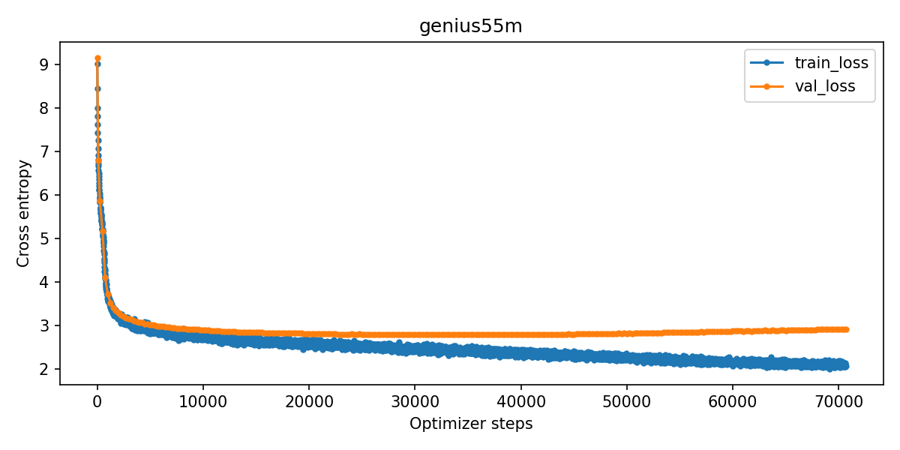

# Genius 55M: языковая модель с нуля

Небольшая decoder-only модель для продолжения русскоязычных песенных текстов. Модель и byte-level BPE-токенизатор обучены с нуля на [Genius Russian](https://huggingface.co/datasets/sevenreasons/genius-lyrics-russian). Используются все жанры без ограничения корпуса в 100 МБ. SFT и чат-шаблон не применяются.

Язык корпуса — русский, домен — песенные тексты. Это доменная постановка задания; русский язык сам по себе не соответствует условию о языке вне топ-50.

| Параметр | Значение |
|---|---|
| Архитектура | Llama, случайная инициализация, без предобученных весов |
| Параметры | 54 817 920 |
| Слои / hidden size / attention heads | 10 / 640 / 10 |
| Размер FFN | 1728 |
| Контекст | 1024 токена |
| Токенизатор | byte-level BPE, 8192 токена |
| Механизмы | RoPE, RMSNorm, SwiGLU, общие веса embedding и LM head |
| Обучение | AdamW, mixed precision, gradient checkpointing, PyTorch SDPA |
| GPU исходного обучения | NVIDIA RTX 3060 Ti, 8 ГБ |

## Установка окружения

Команды выполняются из корня репозитория в **Bash на Linux** или **Git Bash на Windows**. Требуется установленная Conda. Python и основные библиотеки зафиксированы на версиях исходного обучения.

```bash
conda create -n genius55m python=3.12.7 pip -y
conda activate genius55m
python -m pip install torch==2.5.1 --index-url https://download.pytorch.org/whl/cu118
python -m pip install -r requirements.txt
bash scripts/00_check.sh
```

Для обучения нужна NVIDIA GPU с доступной CUDA. Колёса PyTorch включают CUDA runtime; драйвер NVIDIA должен быть совместимым. Команда установки взята из [документации PyTorch 2.5.1](https://pytorch.org/get-started/previous-versions/#v251).

Если нужен только инференс на CPU, вместо CUDA-варианта установите:

```bash
python -m pip install torch==2.5.1 --index-url https://download.pytorch.org/whl/cpu
python -m pip install -r requirements.txt
```

На исходной GPU использовался BF16, при отсутствии его поддержки обучение выбирает FP16. SDPA выбирает доступный backend автоматически. Flash Attention 2 отдельно не устанавливается; в исходной Windows-сборке PyTorch Flash Attention недоступен.

## Быстрый инференс готовой модели

После клонирования репозитория скачайте веса из релиза `v1.0.0`. Скрипт определяет GitHub-репозиторий из `git remote origin`, проверяет SHA256 и распаковывает модель в `artifacts/`:

```bash
python scripts/download_model.py
bash scripts/05_inference.sh \
  --prompt "За зимой приходит" \
  --temperature 0 --max-new-tokens 32
```

Если репозиторий скачан как ZIP, укажите его имя явно:

```bash
python scripts/download_model.py --repo OWNER/REPOSITORY --tag v1.0.0
```

Здесь `OWNER/REPOSITORY` — адрес репозитория на GitHub без `https://github.com/`.

По умолчанию загружается **`artifacts/checkpoints/genius55m/best/`** — лучший чекпоинт по validation loss. Именно на нём получены сохранённые успешные примеры. В релиз также входит **`artifacts/checkpoints/genius55m/last/`** — модель после последнего шага обучения:

```bash
bash scripts/05_inference.sh \
  --checkpoint artifacts/checkpoints/genius55m/last \
  --prompt "За зимой приходит" \
  --temperature 0 --max-new-tokens 32
```

Случайная генерация и многострочный префикс:

```bash
bash scripts/05_inference.sh \
  --prompt $'Вечерний город зажигает фонари\n' \
  --temperature 0.85 --max-new-tokens 100 --seed 42
```

Также поддерживается `--prompt-file prompt.txt`: UTF-8 файл с любым числом строк. Вывод сохраняется в `artifacts/samples/`. Модель продолжает префикс; формат вопроса и ответа без SFT не гарантируется.

## 1. Подготовка корпуса

```bash
bash scripts/01_prepare_data.sh
```

Скрипт скачивает `genius-ru.json` из зафиксированной ревизии `236a5a939c650fa234b9456ff7e58918bc85705f`. Удаляются HTML, ссылки, заголовки `[Припев]`, `[Куплет]`, служебные строки Genius и дубли. Слова самих припевов, переносы строк, пунктуация и английские вставки сохраняются. Отсеиваются слишком короткие, повреждённые, чрезмерно повторяющиеся и преимущественно нерусские тексты. Языковой фильтр использует долю русских букв, а не отдельную модель определения языка.

Песни делятся на train/validation/test. Найденные версии одной песни и общие длинные фрагменты группируются перед разбиением, чтобы уменьшить утечку. Поиск близких дублей приближённый; пересечение исполнителей между частями допускается.

| Корпус | Значение |
|---|---:|
| Исходных записей | 192 020 |
| После очистки | 170 741 |
| Объём очищенных текстов, UTF-8 | 417 393 507 байт |
| Train / validation / test | 167 316 / 1710 / 1715 песен |

Исходник сохраняется в `artifacts/data/raw/`, части корпуса — в `artifacts/data/splits/`. Статистики фильтрации, распределения слов и SHA256 находятся в [data_report.json](artifacts/reports/data_report.json), примеры очистки — в [cleaning_examples.json](artifacts/reports/cleaning_examples.json).

Корпус не включается в Git: команда подготовки скачивает его из источника. В карточке датасета лицензия не указана.

## 2. Обучение токенизатора

```bash
bash scripts/02_train_tokenizer.sh
bash scripts/03_encode_data.sh
```

Обучается один byte-level BPE со словарём 8192 на выборке train объёмом до 20 МБ. Validation и test не используются для подбора словаря. Для всего train проверяется точное восстановление текста и считаются частоты токенов, включая неиспользуемые и редкие.

Перед каждой песней добавляется `<bos>`, после неё — `<eos>`. Идентификаторы записываются в `uint16` массивы, из которых обучение читает блоки по 1024 токена. Блок может пересекать границу песен, разделённых специальными токенами.

Токенизатор находится в `artifacts/tokenizer/`, статистики — в [tokenizer_report.json](artifacts/reports/tokenizer_report.json), массивы — в `artifacts/data/tokenized/`. В train с BOS/EOS **77 167 227 токенов**; контрольные суммы частей сохранены в [manifest.json](artifacts/data/tokenized/manifest.json).

## 3. Обучение модели

Все настройки находятся в [configs/pretrain.json](configs/pretrain.json). По умолчанию используется конфигурация 55M, весь очищенный Genius и бюджет 15 проходов по токенам.

```bash
bash scripts/04_pretrain.sh
```

Если готовая модель уже скачана, используйте другое имя запуска, чтобы обучить новую модель:

```bash
bash scripts/04_pretrain.sh --run my_genius55m
```

Эффективный batch: 4 последовательности × 4 шага накопления × 1024 = **16 384 токена на шаг оптимизатора**. Бюджет — **70 649 шагов**, около **4710 шагов на один проход по числу токенов**. Блоки выбираются случайно с возвращением: 15 проходов — отношение обработанных токенов к размеру train, а не 15 последовательных обходов всех песен.

Оптимизации: BF16/FP16, gradient accumulation, gradient checkpointing с проверкой фактического включения, SDPA. Используются warmup 400 шагов, cosine decay и clipping градиентов. Loss на фиксированной validation-выборке и примеры продолжений сохраняются каждые 250 шагов; `best` обновляется при улучшении validation loss. `last` и состояние optimizer/RNG сохраняются каждые 1000 шагов и при завершении.

Пробный запуск на 100 шагах и продолжение того же запуска:

```bash
bash scripts/04_pretrain.sh --run trial --steps 100
bash scripts/04_pretrain.sh --run trial --resume
```

Чтобы остановить обучение, нажмите Ctrl+C и дождитесь сообщения о сохранении состояния. Продолжение своего запуска:

```bash
bash scripts/04_pretrain.sh --run my_genius55m --resume
```

Для продолжения нужен `training_state.pt`. Релиз для инференса содержит веса `best` и `last`, без optimizer/RNG. Новые запуски сохраняются в `artifacts/checkpoints/<run>/`, логи — в `artifacts/logs/<run>/`.

```bash
bash scripts/08_tensorboard.sh
```

Откройте `http://localhost:6006`. Снимки продолжений на шагах 0, 36 000 и 70 649 сохранены в `artifacts/samples/genius55m/`. Полная история продолжений доступна в TensorBoard.

Сводка обучения и SHA256 обоих чекпоинтов: [training_summary.json](artifacts/reports/training_summary.json). Исходные логи готовой модели включены в [artifacts/logs/genius55m/](artifacts/logs/genius55m/): `metrics.jsonl`, `run.json` и TensorBoard events.

| Состояние готовой модели | Шаг | Validation loss | Perplexity |
|---|---:|---:|---:|
| Случайная инициализация | 0 | 9.1681 | 9586.62 |
| Best | 36 000 | 2.7866 | 16.23 |
| Last | 70 649 | 2.9180 | 18.51 |



## 4. Проверка и демонстрация

Выполненный ноутбук: [notebooks/inference_demo.ipynb](notebooks/inference_demo.ipynb). Он загружает настоящий `best`, генерирует дополнение «За зимой приходит → весна» и сравнивает короткий ответ с сохранённым примером. Для запуска:

```bash
python -m jupyterlab notebooks/inference_demo.ipynb
```

Выберите kernel установленного окружения и выполните все ячейки. Пути определяются относительно репозитория, поэтому ноутбук работает и на Linux, и на Windows. CPU поддерживается для инференса, но может быть медленнее GPU.

Повторить генерацию на отобранных успешных префиксах:

```bash
bash scripts/09_prompt_sweep.sh \
  --prompts configs/inference_examples.json \
  --temperatures 0 --max-new-tokens 32
```

Скрипт сохраняет ответы и метаданные в новую папку `artifacts/reports/prompt_sweep_<дата_время>/`.
Готовая подборка содержит восемь исходных префиксов и 25 дополнительных успешных формулировок:

- [successful_paraphrases.json](artifacts/reports/paraphrases/successful_paraphrases.json) — отобранные короткие дополнения, сгруппированные по примерам, с полными ответами модели.
- [paraphrase_summary.md](artifacts/reports/paraphrases/paraphrase_summary.md) — удобный список префиксов и дополнений.
- [results.json](artifacts/reports/paraphrases/results.json) — исходные ответы для выбранных префиксов.

Подборка демонстрирует успешные короткие дополнения при указанных параметрах генерации.

Оценка на отложенном test с unigram baseline и фиксированными префиксами:

```bash
bash scripts/06_evaluate.sh
```

Сохранённый результат на 512 блоках: **test loss 2.7607**, **perplexity 15.81** (unigram baseline: perplexity 1104.66). Оценка относится к `best`.

По умолчанию оцениваются 512 блоков test; `--max-blocks 0` использует весь test. Результат — `artifacts/reports/evaluation_genius55m.json`. Для своей модели добавьте `--run my_genius55m`. Перед оценкой проверяются SHA256 корпуса и токенизатора. Нужны подготовленные данные из этапов 1–2.

Обновить графики:

```bash
bash scripts/07_plots.sh
```

Графики корпуса, распределения частот токенов и loss сохраняются в `artifacts/reports/figures/`.

## Файлы и релиз модели

```text
configs/pretrain.json                  настройки корпуса, токенизатора и модели
src/data/                             скачивание, очистка, разбиение и кодирование
src/tokenizer/                        обучение BPE
src/model/                            создание модели со случайными весами
src/training/                         претрейн и сохранение состояния
src/inference.py                      генерация
src/evaluation/                       оценка и проверка формулировок
scripts/                              Bash-команды этапов и вспомогательные скрипты
notebooks/inference_demo.ipynb         выполненная демонстрация инференса
artifacts/checkpoints/genius55m/       best, last и локальное состояние обучения
artifacts/tokenizer/                  обученный токенизатор
artifacts/logs/genius55m/              метрики и TensorBoard
artifacts/reports/                    статистики, оценки и графики
artifacts/data/                       локальные данные, исключённые из Git
release/                             архив для GitHub Release
```

Большие веса и корпус исключены из Git через `.gitignore`. Для релиза с тегом **`v1.0.0`** и названием **`Genius 55M — pretrained from scratch`** используются два файла:

- `release/genius55m-v1.0.0.zip` — оба чекпоинта `best` и `last` последней конфигурации Genius 55M, конфиги и токенизатор; исходная структура `artifacts/` сохранена.
- `release/genius55m-v1.0.0.zip.sha256` — контрольная сумма архива.

Оба файла прикрепляются к GitHub Release. Они уже подготовлены; при необходимости собрать их заново:

```bash
python scripts/package_model.py
```

Скрипт скачивания из раздела быстрого инференса использует именно эти имена. Состояние optimizer/RNG и корпус не входят в архив для инференса. Все создаваемые результаты по умолчанию остаются внутри `artifacts/` репозитория.
